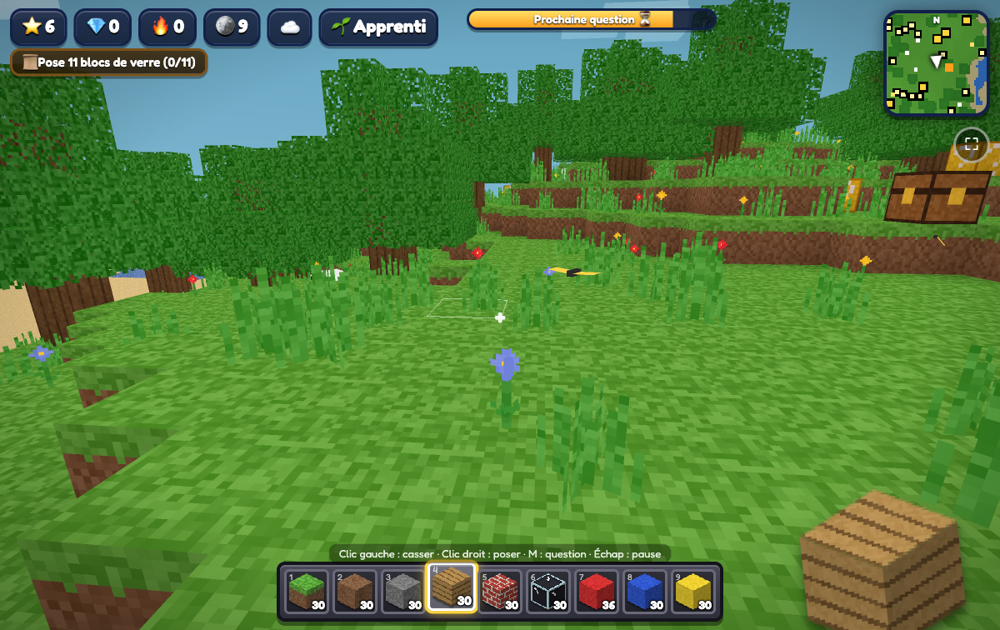
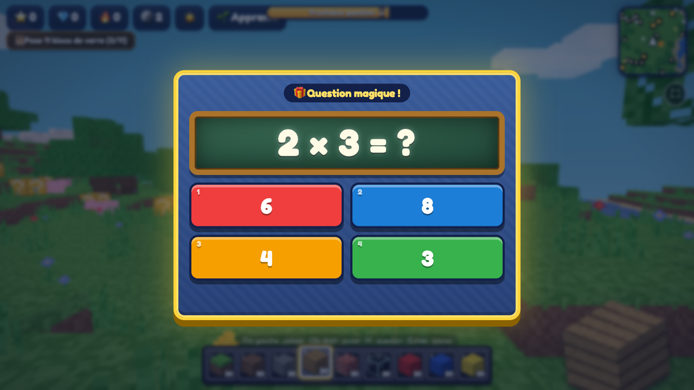
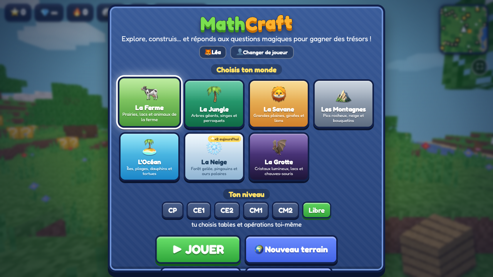

# ⛏️ MathCraft

Un petit jeu de blocs en 3D, façon Minecraft, pour **réviser les maths en jouant** (CP → CM2).
Il tourne directement dans le navigateur, sur **ordinateur, tablette et téléphone**, sans installation.

👉 **Jouer : https://vincentm498.github.io/MathCraft/**



<table>
<tr>
<td></td>
<td></td>
</tr>
</table>

## Le principe

L'enfant explore, construit et casse des blocs. À intervalles réguliers (ou en ouvrant des coffres, en cassant des blocs « ? »…),
une **question de maths** apparaît. Les bonnes réponses rapportent des étoiles, de l'argent, des blocs et des diamants.

- **Niveaux scolaires** : CP, CE1, CE2, CM1, CM2 (ou réglage libre des tables et des opérations), **choisis par le parent** dans l'Espace parent
- **Types de questions** : multiplications, divisions, additions, soustractions, questions à trous, grands nombres
- **Tutoriel** pas à pas au premier lancement (rejouable avec « Comment jouer ? »)
- **Grande carte** : toucher la mini-carte ou touche N
- **Rythme adaptatif** : si l'enfant se trompe souvent, les questions arrivent plus vite et les mêmes calculs ratés reviennent régulièrement (réglable par le parent)
- **Révision du jour** : 10 questions choisies sur les points faibles de l'enfant, avec un cadeau quotidien
- **Coffres au trésor** à code (3 questions), **défi éclair**, missions de construction
- **Le marchand** : on achète des blocs, des compagnons et des accessoires avec des **pépites 🪙** (la monnaie du jeu), mais il faut donner **la somme exacte** !
- **Compagnons** : un seul animal te suit, les autres t'attendent à la maison et s'échangent quand on veut. Chacun a son nom et ses accessoires cumulables (chapeau, lunettes, écharpe, cape…)
- **Photos** : on prend les animaux en photo pour remplir l'album, et ils arrivent alors en vente chez le marchand
- **Réfléchir avant de répondre** : une réponse trop rapide ne rapporte rien, deux erreurs d'affilée déclenchent une mini-correction à recopier, et les parents voient les réponses probablement données au hasard
- **Mode TV** : le jeu sur la télé, le téléphone sert de manette (QR code)
- **Monter son compagnon** (chevaux, lions, vaches…) après l'avoir dressé en répondant calmement ; son humeur dépend de la qualité des réponses
- **Trouvailles** : 40 objets cachés dans les mondes (plus ils sont rares, plus ils sont difficiles à trouver), à offrir à son compagnon
- **Nouveautés** : un bouton du menu affiche l'historique des changements, version par version
- **8 mondes** : la Ferme, la Jungle, la Savane, les Montagnes, l'Océan et ses îles, la Neige, la Grotte et le **Far West 🤠** (chevaux, canyons, cactus), qui ne se débloque qu'en répondant avec soin
- **Météo** (pluie, orage, neige, brouillard), cycle jour/nuit, **sons d'ambiance et musique** générés par monde
- Les **constructions sont sauvegardées** (par enfant et par monde)

### Un monde qui vit
- **Événements surprise** (quelques minutes) : trésor flash (coffre doré visible sur la mini-carte), marchand ambulant (objets rares à -30 %),
  pluie d'étoiles filantes, arc-en-ciel avec coffre magique, spectacle de dauphins, nuée de lucioles, aurore boréale, marée basse avec coquillages.
- **Faune qui change** : animaux de nuit (hiboux, renards), de la pluie (grenouilles, escargots) et **animaux rares** à apprivoiser (licorne, panda roux, baleine, yéti…).
- **Album des animaux** : on les prend en photo (touche C / bouton 📷) ; une médaille par monde complété.
- **Chaque jour** : monde du jour (étoiles ×2), cadeau du jour, 3 quêtes (les mêmes pour tous les enfants), petites surprises, cadeau de retour après quelques jours d'absence.
- **Selon la vraie date** : Pâques (œufs cachés), Halloween (citrouilles), Noël (cadeaux et neige), été (coquillages) ; défi éclair ×2 le week-end.
- **La ferme produit** des œufs, du lait et des fruits toutes les 10 minutes.
- La monnaie du jeu est la **pépite 🪙** (pas de vrais euros).

## Historique des versions

Tout ce qui est ajouté, modifié ou supprimé, version par version : [CHANGELOG.md](CHANGELOG.md) et [Releases](https://github.com/vincentm498/MathCraft/releases).

## Pour les parents

Le bouton **👨‍👩‍👧 Espace parent** (protégé par un code à 4 chiffres) donne, en 4 onglets : **Suivi**, **Réglages du jeu** (niveau scolaire, tables, types de questions, rythme, QCM ou saisie, mode TV), **Sécurité** (temps de jeu, code) et **Données**. Le suivi donne :
temps de jeu, questions, réussite au premier essai, temps de réponse, maîtrise de chaque table,
dernières erreurs (y compris au marchand), conseils, **limite de temps par jour**, niveau scolaire, export/import de sauvegarde.

Plusieurs enfants peuvent jouer sur le même appareil : chacun a sa progression et son profil.

> Les données sont enregistrées **dans le navigateur** (`localStorage`) de l'appareil. Aucun compte, aucun serveur, aucune donnée envoyée (sauf le code de jumelage du mode TV, voir plus bas).
> Utiliser « Exporter » dans l'espace parent pour sauvegarder ou changer d'appareil.

## Commandes

| | Ordinateur | Mobile |
|---|---|---|
| Se déplacer | Z Q S D / W A S D | joystick |
| Regarder | souris (ou glisser) | glisser le doigt |
| Tourner sur place | ← → ↑ ↓ | glisser le doigt |
| Sauter / nager | Espace | ⬆️ |
| Casser / poser | clic gauche / clic droit | toucher, bouton ⛏️/🧱 |
| Question tout de suite | M | ❓ |
| Grande carte | N | toucher la mini-carte |
| Photo d'un animal | C | 📷 |
| Monter / descendre | R | 🐴 / 🚶 |
| Pause | Échap | ⏸ |

## Jouer sur la TV avec le téléphone comme manette

1. Sur l'appareil branché à la télé (ordinateur en HDMI, Chromecast avec cast de l'onglet, AirPlay, navigateur de la TV), ouvrir le jeu puis Espace parent → Réglages du jeu → **📺 Jouer sur la TV** (ou ajouter `?tv` à l'adresse).
2. Sur le téléphone, **scanner le QR code** affiché (ou ouvrir `manette.html` et taper le code à 4 caractères).
3. Le téléphone affiche joystick et boutons ; les questions s'y affichent aussi avec de gros boutons de réponse.

La connexion est directe entre les deux appareils (WebRTC). Seul le code de jumelage transite par le serveur public de mise en relation de [PeerJS](https://peerjs.com) : ni nom, ni progression, ni réponse. Il faut Internet des deux côtés, et un clic sur la télé pour activer le son.

## Jouer en plein écran sur mobile

- **Android (Chrome)** : le bouton **⛶** du jeu passe en plein écran. Pour une vraie appli : menu ⋮ → *Installer l'application*.
- **iPhone / iPad (Safari)** : Safari n'autorise pas le plein écran dans une page. Toucher **Partager ⬆️ → « Sur l'écran d'accueil »**, puis ouvrir MathCraft depuis la nouvelle icône : le jeu s'ouvre sans barre de navigateur.
- **Ordinateur** : F11 ou le bouton ⛶.

Une fois installé, le jeu fonctionne aussi **hors ligne**.

## Lancer en local

Les fichiers sont statiques. Ouvrir `index.html`, ou lancer un petit serveur :

```bash
python3 -m http.server 8080
```

puis ouvrir http://localhost:8080. Ajouter `?debug` à l'adresse (`index.html?debug`) active le **mode debug**, réservé aux tests :
tous les mondes sont débloqués, **aucune question** ni calcul, crédits, diamants et blocs **illimités** (∞), achats gratuits chez le marchand,
coffres ouverts directement, pas de limite de temps, et le **vol** (touche F, bouton 🕊️) n'existe **que** dans ce mode. Rien n'est ajouté à la progression de l'enfant.

## Technique

- JavaScript sans framework + [Three.js](https://threejs.org/) r160 (`three.min.js`, licence MIT)
- Mode TV : [PeerJS](https://peerjs.com) et [qrcode-generator](https://github.com/kazuhikoarase/qrcode-generator) (`lib/`, licence MIT), chargés seulement dans ce mode
- Textures, sons et musique **générés par code** : aucun fichier image ou audio
- `index.html`, `style.css`, `game.js`
